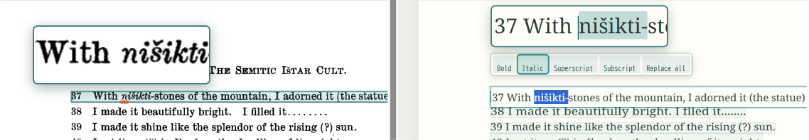
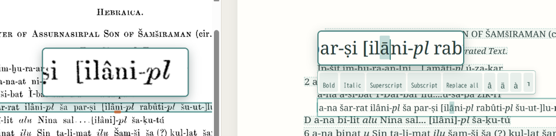
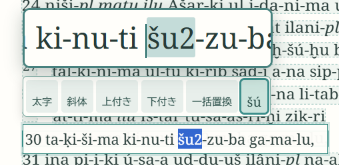

校正画面では、ページ画像とレイアウトを再現した OCR テキストを左右のペインで見比べられます。

右ペインのテキストをクリックすると、その行を編集できます。左右ペインに拡大鏡が表示され、カーソル近くの文字が拡大して表示されます。

### 装飾

文字を選択すると、ツールバーが表示されます。ツールバーでは選択文字に対してボールド・イタリック・上付き文字・下付き文字の装飾を指定できます。

イタリック・上付き文字・下付き文字はOCR時に自動認識して適用されます。

上付き・下付き文字の判定条件は、「上付き・下付き文字の自動認識」ボタンをクリックすると専用画面で調整できます。

### 認識候補文字

編集行で文字を1文字だけ選択すると、その文字の別の認識候補がツールバーに表示されます。認識候補をクリックするとその文字に置き換えられます。

### 翻字記号の入力

アクセント付き記号のようにアッシリア学文献の翻字に使用する文字を簡単に入力する方法があります。

#### アクサングラーブ

 記号の読みの2番と3番を表すためのアクセントは、末尾数字付きの翻字を入力して範囲選択すると、ツールバーに変換候補が表示されます。下の例では`šu2`を`šú`に変換しています。変換は、選択範囲の最初の母音に対して行われます。例えば　`gestug2`は`géstug`に変換されます。

#### その他の記号

その他の記号は下記のような規則で変換されます。上の規則と組み合わせることもできます。例えば上の例では`cu2`と入力して選択すると`šú`に変換できます。

| 入力文字 | 変換後 |
| ----- | ------- |
| c     | š       |
| sz    | š       |
| s,    | ṣ       |
| t,    | ṭ       |
| t_    | ṯ       |
| k,    | ḳ       |
| K,    | Ḳ       |
| [[    | ⸢       |
| ]]    | ⸣       |
| j     | ŋ       |
| g~    | g̃       |
| g^    | ĝ       |
| h     | ḫ       |
| h,    | ḥ       |
| a^    | â       |
| i^    | î       |
| u^    | û       |
| o^    | ô       |
| e^    | ê       |
| a~    | ā       |
| i~    | ī       |
| u~    | ū       |
| o~    | ō       |
| '     | ʿ       |
| `     | ʾ       |

### 一括置換
複数個所の文字を一括して校正する機能です。[一括置換](replace-all)を参照してください。

### 変更の保存
変更はプロジェクトに自動保存されます。誤操作は Undo / Redo で戻したり、やり直したりできます。校正が済んだページは、ページ単位の「校正完了」チェックを付けると、作業状態を記録できます。

