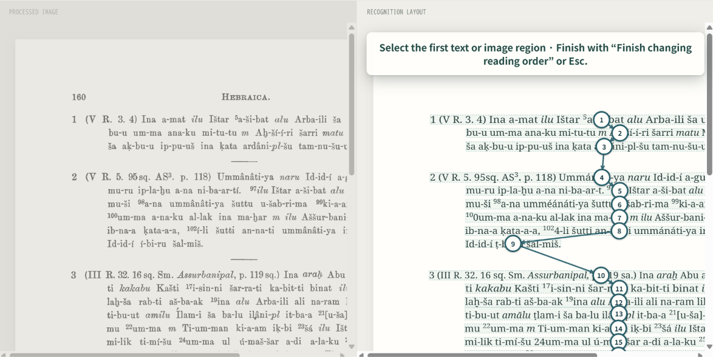

OCR 領域の追加はページ画像側で操作します。「追加」を選び、画像上で範囲をドラッグすると、その範囲を OCR して結果に加えます。

OCR 結果のレイアウト側では、行をクリックまたは範囲をドラッグして削除できます。複数行を囲んで結合する操作もあります。

読み順の変更も OCR 結果側で行います。「読み順を変更」をクリックすると、読み順変更モードが始まります。テキストブロックごとに番号が振られ、読み順ごとに線で繋がって表示されます。読み順を変更する場合は、正しい読み順の番号をクリックした後、順番にページ上の行をクリックしてください。この読み順は校正結果を出力するときの出力順に適用されます。

