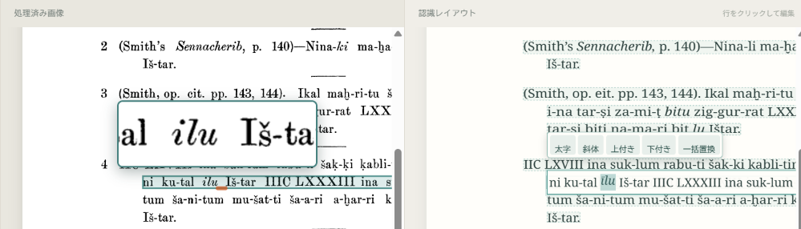
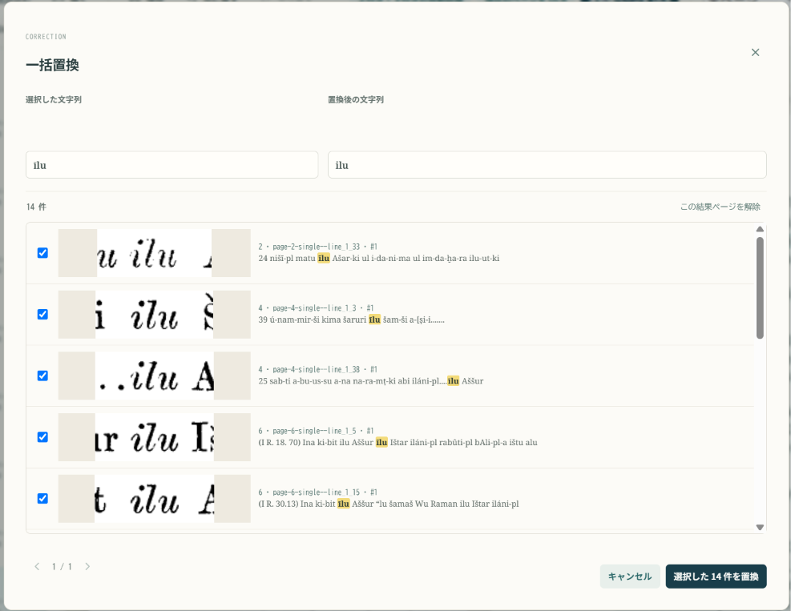

OCRされたテキストでは、往々にして同じ誤りが繰り返されるものです。

例えばここではiluというテキストがīluと誤って読まれていますが、別の箇所でも同じようにiluがīluと読まれていることに気が付いたとしましょう。

ひとつひとつ訂正してもいいのですが、一括置換という機能を使うことで簡単に複数個所を訂正できます。

## 手順

1. 編集テキストの一部を選択します。ここではīluと読まれている部分を選択します。
2. ツールボックスから「一括置換」をクリックします。

下のようなダイアログが表示されますので、「置換後の文字列」欄を編集して訂正します。画面の下の方には文献全体から同じ文字列に読まれた箇所が並んで表示されますので、画像を見ながら同じ誤りをしているものにチェックを入れてください。

「選択されたxx件を置換」をクリックすると、それらが一度に置換されます。