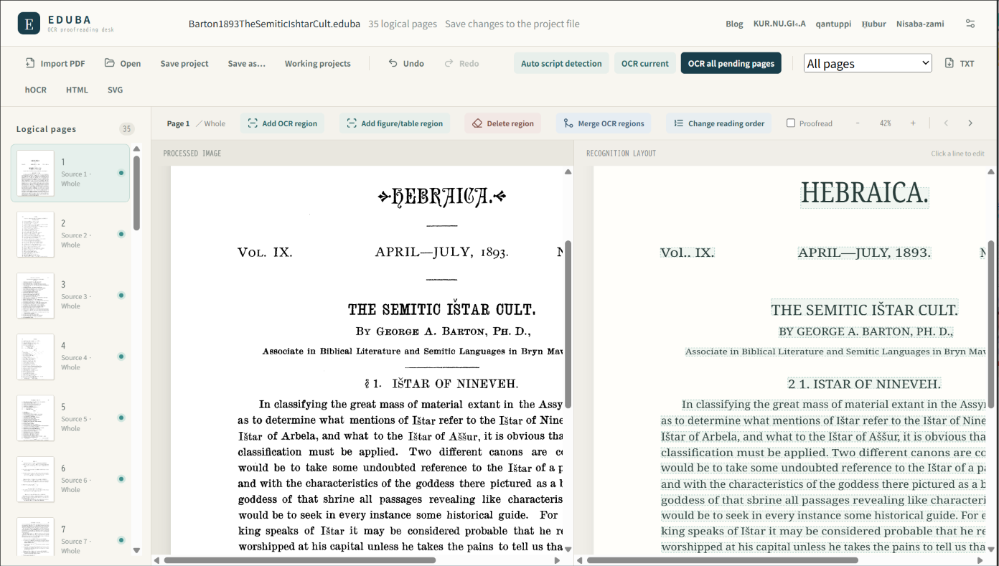

import { LinkButton } from '@astrojs/starlight/components';

Eduba は、アッシリア学文献のデジタル化を支援するアプリケーションです。翻字記号を学習したOCRエンジンと充実した校正機能を搭載しています。ページ画像とレイアウトを再現したテキストが左右に並び、見比べながら校正できます。

Edubaにはブラウザ版とデスクトップ版があります。ブラウザ版はお使いのブラウザでいますぐ利用できます。

<LinkButton href={`${import.meta.env.BASE_URL}app/`} icon="external">ブラウザ版を開く</LinkButton>

プロジェクトは `.eduba` ファイルに保存できます。ブラウザ版の作業内容はブラウザ内に自動保存され、持ち運びやバックアップには「プロジェクトを保存」でファイルを書き出します。

## 主な機能

- PDF を取り込み、ノンブルや柱などOCR不要な領域を指定
- 見開きページの分割、ページ傾きの自動補正
- アッシリア文献に特化してトレーニングした専用Tesseractモデルを使用したテキスト化
- OCR 結果の行編集、候補確認、装飾の指定、置換、一括置換
- テキストブロックの読み順指定
- 読み順を保った OCR 領域の追加、削除、結合、並べ替え
- TXT、hOCR、SVG への書き出し

まずは [ブラウザ版の使い方](/getting-started/browser/)、[Windows へのインストール](/getting-started/installation/)、[最初のプロジェクト](/getting-started/first-project/) をご覧ください。

:::caution
デスクトップ版は現在 Windows 向けです。ブラウザ版の保存方法と制限は、ブラウザ版の使い方をご覧ください。
:::

